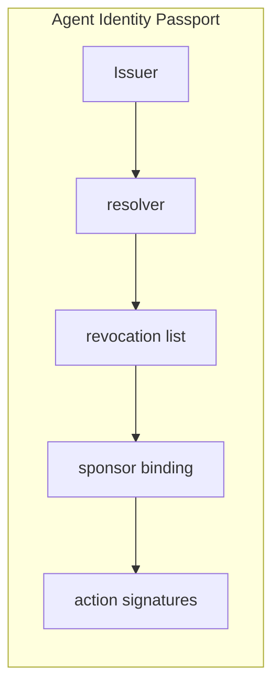

# Agent Identity Passport

  

> A portable, attest-able identity for autonomous agents independent of their host app.

**Repository:** [https://github.com/AIFrontiersLab/AgentIdentity](https://github.com/AIFrontiersLab/AgentIdentity)

---

## Why this exists

Agents are currently just API keys inside someone else's account.

**Why now:** Multiple stacks are inventing incompatible agent IDs at once.

**What recently changed:** A2A-style protocols and tool-using agents in production pilots.

**Why it was hard before:** No persistent non-human actors with cross-system actions.

---

## Product thesis

| | |
|---|---|
| **Future thesis** | Without identity, nothing else in the agent stack (auth, pay, insure) composes. |
| **First customer** | An agent platform that needs audit-grade actor IDs |
| **Market** | Identity infrastructure |
| **Convergence** | Agent Identity, Authorization |
| **Moat** | Issuer network + revocation + sponsor graph. |

---

## MVP

Issue a DID for an agent, bind it to a sponsor, sign actions, verify elsewhere.

### Core loop

1. Accept an agent (or human-on-behalf-of-agent) intent
2. Enforce scope / policy / evidence
3. Execute the smallest useful autonomous step
4. Leave an audit trail a human can kill-switch

---

## Architecture

```text
Issuer, resolver, revocation list, sponsor binding, action signatures.
```



---

## Start

```bash
python3 -m http.server 4173 --directory .
```

---

## Why it may win

It is the substrate other primitives require.

## Why it may fail

Too infrastructural; no buyer until a crisis.

### Risks

- Standards freeze around a big-tech format

### Unknowns

- Governance of issuers

### Current alternatives

- Service accounts
- API keys
- workload identity

### Assumptions

- Cross-vendor agent actions will matter

---

## Scope

This project is intentionally scoped to **AI and Agentic AI** only.

---

## Tags

`ai` `agentic-ai` `autonomous-agents` `nocta` `prototype` `agent-identity` `authorization`
